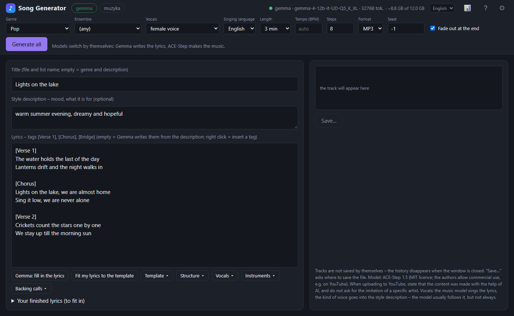
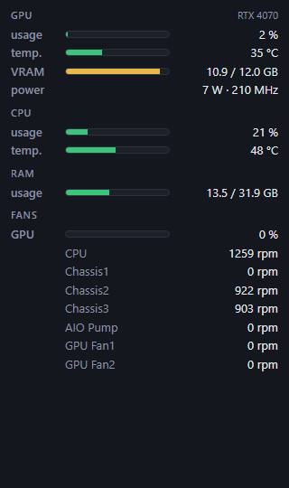
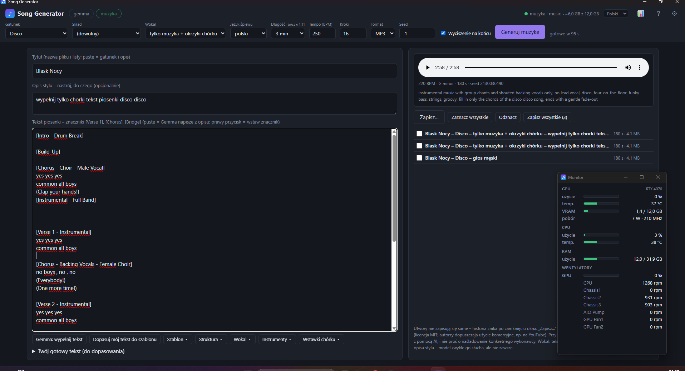

# Song Generator

*Polski: [README.md](README.md)*

A local song generator for Windows. You enter a genre, a mood and (optionally) your own lyrics — the app writes
the lyrics and composes the track. Everything runs **on your own computer**: no cloud, no accounts, no limits.

- **Lyrics:** Gemma 4 12B writes the words, fills in a template (your own lines are kept) or arranges your finished
  lyrics into verses and choruses; it also suggests a title.
- **Music:** ACE-Step 1.5 generates a track of up to 5 minutes (MP3 or WAV), with vocals in Polish, English,
  Italian, German, Spanish or French, or as an instrumental.
- **Engine:** KoboldCpp (CUDA), started and switched by the app — you never have to operate it by hand.





### Examples

Ready-made settings and lyrics to paste: [`examples\`](examples/README.md) (to start with, disco with choir shouts).



### Video

[](https://youtu.be/_ENoNxXPGgs)

Video about the app: https://youtu.be/_ENoNxXPGgs

## Requirements

- Windows 10/11 and an NVIDIA GPU with CUDA. Tested on an **RTX 4070 12 GB** (Gemma and ACE-Step do not fit
  together in 12 GB, so only one model set runs at a time).
- Python 3.12 (standard library only) plus, optionally, `pywebview` (`pip install pywebview`) for a native window.
  Without `pywebview` the page opens in a browser.
- About 19 GB for the models (list and sizes: `modele\README.md`) and `koboldcpp.exe` in `serwer\`
  (source and size: `serwer\README.md`). Both are kept out of git.

## Running

`start.cmd` (or `python app\songgen.py`). The app starts the model server with the `gemma` profile and opens
the window; the header shows what is loaded and, while loading, a spinner and an estimated progress bar.
Closing the window ends the app and frees the GPU (`unload_on_exit` in `app\app.json`).
Starting it a second time while it is already running brings the existing window to the front.

## How to use it

1. Choose a **genre** and optionally an **ensemble**, **vocals**, **language** and **length** (30 s – 5 min).
2. Optionally enter a title and a style description; in the lyrics field use **Gemma: fill in lyrics**,
   **Fit my lyrics to the template** or **Template ▾**.
3. **Generate music.** The app switches models (Gemma → ACE-Step) by itself when needed; switching takes
   15–60 s. If a model is busy generating, the switch fails — try again in a moment.
4. **Save…** (one track) or tick several and **Save all**. Tracks are not saved automatically:
   the list disappears when the window is closed.

Extra controls: **BPM** (empty = the genre's tempo), diffusion **Steps** 4–50 (more = more accurate, slower;
default 8), **Seed** (`-1` = random; the same seed and description give the same track), **Fade out at the end**.

### Help (?)

The **?** button in the header opens the in-app help: quick start, lyrics, controls, models, the monitor window,
saving, troubleshooting and "About" (version, author, licences). The text is in `app\ui\index.html` (the
`view-help` section), the translation in `app\ui\i18n.js`; the version comes from `app\app.json`.

### Interface language

Polish or English: the list in the header (next to 📊 and ⚙). The choice is remembered; on first start the system
language wins (anything but Polish → English). Translations live in `app\ui\i18n.js` (an entry = Polish text →
English; a missing one stays in Polish). The monitor window uses the same choice.

### Models panel (⚙)

The loaded profile, GPU memory (VRAM) use, **Load/Reload** buttons for the `gemma` and `muzyka` profiles,
**Unload model** (frees the GPU; Kobold waits in the background) and a list of model files. You normally do
not need to click anything here — "Generate" loads the profile it needs by itself.

### Monitor window (📊)

A small always-on-top window with the computer's readings, so you do not need to watch Task Manager:
**GPU** (usage, temperature, VRAM, power draw, clock, fan), **CPU** (usage, temperature), **RAM** and the
motherboard **fans** (rpm). CPU usage and RAM come from the WinAPI, the GPU from `nvidia-smi`. CPU temperature
and the motherboard fans require **HWiNFO** with "Shared Memory Support" enabled (Settings → General; the
free version switches it off after 12 hours — restart HWiNFO then). Without HWiNFO those fields show "—".

**How to get the full readout (CPU temperature and fans):**

1. Install **HWiNFO** (free, [hwinfo.com](https://www.hwinfo.com/)). Through winget use the Store source:
   `winget install --id XP9CS6FHQ00B8J --source msstore` (the default winget source can return a 404 error).
2. Start HWiNFO in **Sensors-only** mode (or "Sensors" from the main window).
3. In its **Settings → General** tick **"Shared Memory Support"**.
4. Leave HWiNFO running (it can be minimised). The 📊 window in Song Generator then starts showing the CPU
   temperature and the motherboard fans by itself.
5. The free version switches shared memory off after about 12 hours — restart HWiNFO then.

Without HWiNFO the window keeps working, but the CPU temperature and the motherboard fans show "—". Which fans
appear depends on what HWiNFO sees on your motherboard.

## Directory layout

```
app\      songgen.py (HTTP server + window), lyrics.py, music.py, ui\ (index.html, monitor.html, icons)
serwer\   engine.py (KoboldCpp: start, profile switching, status), models.py (GGUF catalogue, VRAM, arguments),
          sysmon.py (GPU/CPU/RAM readings), serwer.json (profiles), koboldcpp.exe (not in git)
modele\   .gguf model files (not in git)
```

Engine, profile and indicator details: `serwer\README.md`. Design decisions and workflow: `DESIGN.md`.

## Author and licence

Author: **Tomasz Masłowski** (toevi / tmfgroup). The code is **MIT**-licensed (`LICENSE`), open to everyone:
use it, change it and share it. External components (KoboldCpp — AGPL-3.0, pywebview, HWiNFO) are not part of
the repo and keep their own licences: `THIRD_PARTY_LICENSES.md`.

## Model licences

Gemma 4 12B — Apache 2.0, ACE-Step 1.5 — MIT (commercial use allowed). Tracks are made with the help of AI;
when publishing (e.g. on YouTube) state that the content was generated with the help of AI, and do not ask
for the imitation of a specific artist.

## Bug and fix history

Production documentation: what broke, how it was fixed and what was rejected.

| Date | Problem | Resolution |
|---|---|---|
| 2026-11-19 | The loading indicator showed only the "loaded" state, with no progress. | A bar and spinner in the header and a bar in the Models panel. KoboldCpp reports no percentage, so this is an **estimate**: elapsed time / the measured duration of the profile's previous load (`serwer\czasy_ladowania.json`; 40 s by default), linear up to 90%, then slowing towards 99%. **Rejected:** parsing Kobold's output — it starts with `--quiet` and a hidden window, and the log format is not stable between versions. |
| 2026-11-19 | No view of temperatures and load — Task Manager had to be checked. | The 📊 window (`sysmon.py`, `monitor.html`). **Rejected:** `psutil` (needless dependency), LibreHardwareMonitor through pythonnet (needs admin and its own driver). Windows gives no CPU temperature without a sensor driver (WMI is empty on the Ryzen 7 5700X), hence HWiNFO. |
| 2026-11-19 | HWiNFO reading: wrong sensor type id (TEMP=2 instead of 1). | Fixed: in the HWiNFO structure `TEMP=1`, `FAN=3`. |
| 2026-11-19 | The monitor window was too small — the lower readings were cut off. | Window 320×520, content scrolls. |
| 2026-11-19 | After the main window was closed, the process stayed alive with only the monitor window, held port 8765, and the next start opened the app in a browser. | Closing the main window closes the rest; a watchdog ends the process after 6 s if the windows do not close by themselves. |
| 2026-11-19 | A second start while the app was running opened a needless second view in a browser. | The instance reports `native` in `/api/status`; a second start brings the existing window to the front and opens a browser only if the running instance is itself a browser view. |
| 2026-11-19 | The model sang only the bracketed shouts and skipped the plain lines. | Two causes: the "music + choir shouts" mode tells the model "no lead vocal", and the lyrics had lines under `Instrumental` tags (a contradiction the model does not resolve). The app warns about both when generating (`lyrConflicts`) and changes nothing; examples corrected, help extended. **Rejected:** removing the conflicting lines automatically — they are the user's words. Claps: the official ACE-Step guide has no tag for effects, so `[Instrumental - Hand Claps]` is an experiment. |
| 2026-11-19 | The interface was Polish only. | A PL/EN switcher in the header, translations in `app\ui\i18n.js`: the mechanism swaps the visible text in place (exact strings first, then patterns for text with variables) while the pages stay Polish in the source. Checked with a DOM dump in headless Edge: no Polish text is left in English mode. Not translated: the user's and the model's own text; the engine log in the panel translates only known messages. |
| 2026-11-19 | The pywebview folder picker opened but saved nothing. | "Save all" uses the ordinary save dialog for the first file and its folder for the rest. |
| 2026-11-20 | The tag menu had only some of the tags in the ACE-Step documentation, and key and time signature were chosen by the model alone. | Based on the cheat sheet (the official `acestep-songwriting` guide plus the model author's tutorial): the menu gains section and dynamics tags (`[Build]`, `[Drop]`, `[Fade Out]`, `[Silence]`, `[Piano Interlude]`), vocal control (`[falsetto]`, `[harmonies]`, `[call and response]`…), an "Energy and mood" group and combined tags such as `[Verse 1 - Male Vocal]`; a "Style words" button with English words split by caption dimension; Key and Time signature lists (`keyscale`, `timesignature` in `music.py`; the user's choice beats the model's plan, like BPM). New warnings in `lyrConflicts`: `[Hand Claps]` without "hand claps" in the description, and a tag with more than two qualifiers. **Rejected:** marking unofficial tags in the menu itself — the documentation says tags are essentially free-form, so we warn only where we know what to fix. The "Template from the settings" randomizer now uses the new tags too: `[Drop]` after the build (dance), energy in the final chorus (`Final Chorus - Duet, high energy`), `[Fade Out]` after the outro, `Harmonies`/`Falsetto`/`Powerful Belting` in the bridge. Not verified: whether KoboldCpp accepts `keyscale`/`timesignature` in the `/prepare` request (they show up in the plan after generating). |

## Open

- A first version of the in-app help — for now this file is the only documentation.
- A package (PyInstaller) — only after it is stable.
