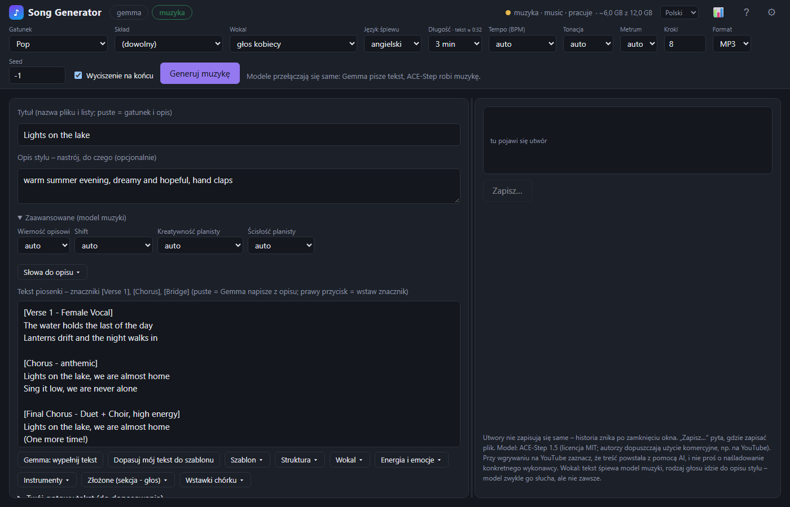
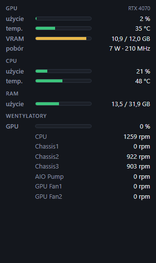
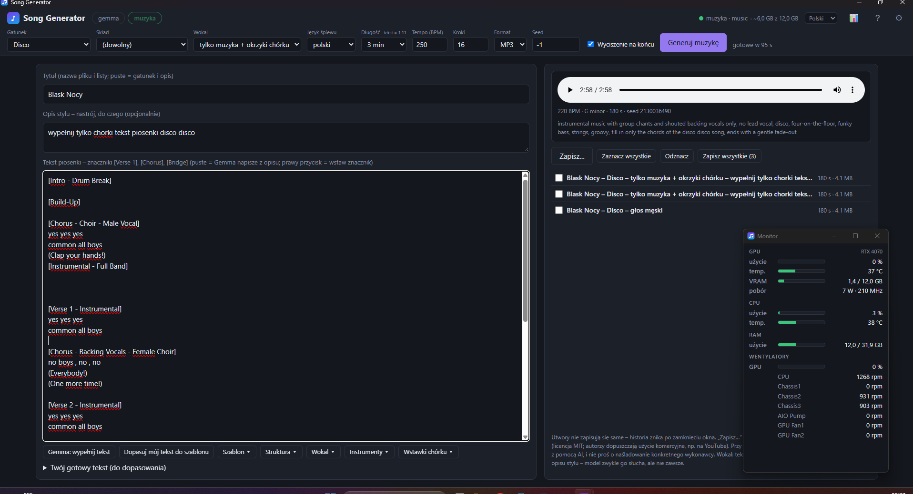

# Song Generator

*English: [README.en.md](README.en.md)*

Lokalny generator piosenek na Windows. Wpisujesz gatunek, nastrój i (opcjonalnie) tekst — aplikacja sama
napisze tekst i skomponuje utwór. Wszystko działa **na twoim komputerze**: bez chmury, bez kont, bez limitów.

- **Tekst:** Gemma 4 12B pisze słowa piosenki, wypełnia szablon (twoje wersy zostają) albo układa twój gotowy tekst
  w strukturę zwrotek i refrenów; proponuje też tytuł.
- **Muzyka:** ACE-Step 1.5 generuje utwór do 5 minut (MP3 lub WAV), z wokalem w języku polskim, angielskim,
  włoskim, niemieckim, hiszpańskim lub francuskim, albo sam podkład.
- **Silnik:** KoboldCpp (CUDA), uruchamiany i przełączany przez aplikację — nie trzeba go obsługiwać ręcznie.





### Przykłady

Gotowe ustawienia i tekst do wklejenia: [`examples\`](examples/README.md) (na początek disco z okrzykami chóru).



### Film

[](https://youtu.be/_ENoNxXPGgs)

Film o aplikacji: https://youtu.be/_ENoNxXPGgs

## Wymagania

- Windows 10/11, karta NVIDIA z CUDA. Sprawdzone na **RTX 4070 12 GB** (Gemma i ACE-Step nie mieszczą się
  razem w 12 GB, więc zawsze działa jeden zestaw modeli).
- Python 3.12 (tylko biblioteka standardowa) + opcjonalnie `pywebview` (`pip install pywebview`) dla natywnego okna.
  Bez `pywebview` strona otwiera się w przeglądarce.
- ok. 19 GB na modele (lista i rozmiary: `modele\README.md`) oraz `koboldcpp.exe` w `serwer\`
  (źródło i rozmiar: `serwer\README.md`). Jedno i drugie jest poza gitem.

## Uruchomienie

`start.cmd` (albo `python app\songgen.py`). Aplikacja startuje serwer modeli z profilem `gemma` i otwiera okno;
pasek w nagłówku pokazuje, co jest załadowane, a podczas ładowania — kółko i szacowany postęp.
Zamknięcie okna kończy aplikację i zwalnia kartę graficzną (`unload_on_exit` w `app\app.json`).
Drugie uruchomienie przy działającej aplikacji wynosi jej okno na wierzch.

## Jak z tego korzystać

1. Wybierz **gatunek**, ewentualnie **skład**, **wokal**, **język**, **długość** (30 s – 5 min).
2. Opcjonalnie wpisz tytuł i opis stylu; w polu tekstu użyj **Gemma: wypełnij tekst**, **Dopasuj mój tekst do
   szablonu** albo **Szablon ▾**.
3. **Generuj muzykę.** Aplikacja sama przełączy modele (Gemma → ACE-Step), jeśli trzeba; przełączenie trwa
   15–60 s. Jeśli model akurat generuje, przełączenie się nie uda — spróbuj za chwilę.
4. **Zapisz…** (jeden utwór) albo zaznacz kilka i **Zapisz wszystkie**. Utwory nie zapisują się same:
   historia znika po zamknięciu okna.

Dodatkowe pokrętła: **BPM** (puste = tempo gatunku), **Kroki** dyfuzji 4–50 (więcej = dokładniej, wolniej;
domyślnie 8), **Seed** (`-1` = losowo; ten sam seed i opis dają ten sam utwór), **Wyciszenie na końcu**.

### Pomoc (?)

Przycisk **?** w nagłówku otwiera pomoc w aplikacji: szybki start, tekst piosenki, pokrętła, modele, okienko
monitora, zapisywanie, rozwiązywanie problemów i „O programie” (wersja, autor, licencje). Treść jest w
`app\ui\index.html` (sekcja `view-help`), tłumaczenie w `app\ui\i18n.js`; wersja pochodzi z `app\app.json`.

### Język interfejsu

Polski albo angielski: lista w nagłówku (obok 📊 i ⚙). Wybór jest zapamiętany; przy pierwszym uruchomieniu
wygrywa język systemu (inny niż polski → angielski). Tłumaczenia leżą w `app\ui\i18n.js` (wpis = polski tekst →
angielski; brakujący zostaje po polsku). Okienko podglądu używa tego samego wyboru.

### Panel Modele (⚙)

Załadowany profil, zajętość karty (VRAM), przyciski **Załaduj/Przeładuj** dla profili `gemma` i `muzyka`,
**Wyłącz model** (zwalnia kartę, Kobold czeka w tle) i lista plików modeli. Zwykle nic tu nie trzeba klikać —
„Generuj” ładuje potrzebny profil samo.

### Okienko podglądu (📊)

Małe okno zawsze na wierzchu z odczytami komputera, żeby nie zaglądać do Menedżera zadań: **GPU** (użycie,
temperatura, VRAM, pobór mocy, zegar, wentylatory), **CPU** (użycie, temperatura), **RAM**, **wentylatory**
z płyty (obr./min). Użycie CPU i RAM idą z WinAPI, GPU z `nvidia-smi`. Temperatura CPU i wentylatory płyty
wymagają **HWiNFO** z włączoną opcją „Obsługa pamięci współdzielonej” (Ustawienia → Ogólne; wersja darmowa
wyłącza ją po 12 godzinach — wtedy uruchom HWiNFO od nowa). Bez HWiNFO te pola pokazują „—”.

**Jak mieć pełny podgląd (temperatura CPU i wentylatory):**

1. Zainstaluj **HWiNFO** (darmowy, [hwinfo.com](https://www.hwinfo.com/)). Przez winget działa źródło sklepu:
   `winget install --id XP9CS6FHQ00B8J --source msstore` (domyślne źródło winget potrafi zwrócić błąd 404).
2. Uruchom HWiNFO w trybie **Sensors-only** (albo „Sensors” z głównego okna).
3. W jego **Ustawieniach → Ogólne** zaznacz **„Obsługa pamięci współdzielonej”** (*Shared Memory Support*).
4. Zostaw HWiNFO uruchomiony (może być zminimalizowany). Okienko 📊 w Song Generator samo zacznie pokazywać
   temperaturę CPU i wentylatory płyty.
5. Wersja darmowa wyłącza pamięć współdzieloną po ok. 12 godzinach — wtedy uruchom HWiNFO ponownie.

Bez HWiNFO okienko działa dalej, ale temperatura CPU i wentylatory płyty pokazują „—”. Które wentylatory się
pojawią, zależy od tego, co widzi HWiNFO na twojej płycie.

## Struktura katalogów

```
app\      songgen.py (serwer HTTP + okno), lyrics.py, music.py, ui\ (index.html, monitor.html, ikony)
serwer\   engine.py (KoboldCpp: start, przełączanie profilu, stan), models.py (katalog GGUF, VRAM, argumenty),
          sysmon.py (odczyty GPU/CPU/RAM), serwer.json (profile), koboldcpp.exe (poza gitem)
modele\   pliki .gguf (poza gitem)
```

Szczegóły silnika, profili i wskaźników: `serwer\README.md`. Założenia i przepływ pracy: `DESIGN.md`.

## Autor i licencja

Autor: **Tomasz Masłowski** (toevi / tmfgroup). Kod na licencji **MIT** (`LICENSE`), otwarty dla wszystkich:
możesz go używać, zmieniać i rozpowszechniać. Składniki zewnętrzne (KoboldCpp — AGPL-3.0, pywebview, HWiNFO) nie
są częścią repo i mają własne licencje: `THIRD_PARTY_LICENSES.md`.

## Licencje modeli

Gemma 4 12B — Apache 2.0, ACE-Step 1.5 — MIT (użycie komercyjne dozwolone). Utwory powstają z pomocą AI; przy
publikacji (np. na YouTube) zaznacz, że treść została wygenerowana z pomocą AI, i nie proś o naśladowanie
konkretnego wykonawcy.

## Historia błędów i poprawek

Dokumentacja produkcyjna: co się psuło, jak naprawiono i co odrzucono.

| Data | Problem | Rozwiązanie |
|---|---|---|
| 2026-11-19 | Wskaźnik ładowania pokazywał tylko stan „załadowany”, bez postępu. | Pasek i kółko w nagłówku oraz pasek w panelu Modele. KoboldCpp nie podaje procentu, więc to **szacunek**: czas / zmierzony czas poprzedniego ładowania profilu (`serwer\czasy_ladowania.json`; domyślnie 40 s), do 90% liniowo, potem zwalnia do 99%. **Odrzucone:** parsowanie wyjścia Kobolda — startuje z `--quiet` i ukrytym oknem, a format logu nie jest stabilny między wersjami. |
| 2026-11-19 | Brak podglądu temperatur i obciążenia — trzeba było zaglądać do Menedżera zadań. | Okienko 📊 (`sysmon.py`, `monitor.html`). **Odrzucone:** `psutil` (zbędna zależność), LibreHardwareMonitor przez pythonnet (wymaga admina i własnego sterownika). Temperatury CPU Windows nie daje bez sterownika czujników (WMI puste na Ryzen 7 5700X), stąd HWiNFO. |
| 2026-11-19 | Odczyt HWiNFO: zły numer typu czujnika (TEMP=2 zamiast 1). | Poprawione: w strukturze HWiNFO `TEMP=1`, `FAN=3`. |
| 2026-11-19 | Okienko podglądu okazało się za małe — dolne odczyty ucięte. | Okno 320×520, treść z przewijaniem. |
| 2026-11-19 | Po zamknięciu głównego okna proces zostawał z samym oknem podglądu, trzymał port 8765, a następny start otwierał aplikację w przeglądarce. | Zamknięcie głównego okna zamyka resztę; watchdog kończy proces po 6 s, jeśli okna nie zamkną się same. |
| 2026-11-19 | Drugie uruchomienie przy działającej aplikacji otwierało zbędny drugi widok w przeglądarce. | Instancja zgłasza `native` w `/api/status`; drugi start wynosi istniejące okno na wierzch, a przeglądarkę otwiera tylko wtedy, gdy działająca instancja sama jest widokiem w przeglądarce. |
| 2026-11-19 | Model śpiewał tylko okrzyki w nawiasach, a zwykłe wersy pomijał. | Dwie przyczyny: tryb „tylko muzyka + okrzyki” mówi modelowi „no lead vocal”, a w tekście były wersy pod znacznikami `Instrumental` (sprzeczność, której model nie rozstrzyga). Aplikacja ostrzega o obu przy generowaniu (`lyrConflicts`) i niczego nie zmienia; przykłady poprawione, pomoc uzupełniona. **Odrzucone:** automatyczne usuwanie sprzecznych wersów — to słowa użytkownika. Klaskanie: oficjalny przewodnik ACE-Step nie ma tagu na efekty, znaczniki `[Instrumental - Hand Claps]` są eksperymentem. |
| 2026-11-19 | Interfejs był tylko po polsku. | Przełącznik PL/EN w nagłówku, tłumaczenia w `app\ui\i18n.js`: mechanizm podmienia widoczny tekst w miejscu (dokładne napisy, potem wzorce dla tekstów ze zmiennymi), a strony w źródle pozostają po polsku. Sprawdzone zrzutem DOM w Edge headless: po angielsku nie zostaje polski tekst. Nie tłumaczone: teksty użytkownika i modelu; log silnika w panelu tłumaczy tylko znane komunikaty. |
| 2026-11-19 | Okno zapisu pywebview (wybieracz folderu) otwierało się, ale nic nie zapisywało. | „Zapisz wszystkie” używa zwykłego okna zapisu dla pierwszego pliku, a jego folder dla reszty. |
| 2026-11-20 | Menu znaczników miało tylko część tagów z dokumentacji ACE-Step, a tonację i metrum wybierał wyłącznie model. | Na podstawie ściągi (oficjalny przewodnik `acestep-songwriting` + poradnik autora modelu): menu o tagi sekcji i dynamiki (`[Build]`, `[Drop]`, `[Fade Out]`, `[Silence]`, `[Piano Interlude]`), sterowanie głosem (`[falsetto]`, `[harmonies]`, `[call and response]`…), grupę „Energia i emocje” i tagi złożone typu `[Verse 1 - Male Vocal]`; przycisk „Słowa do opisu” z angielskimi słowami podzielonymi na wymiary opisu; listy Tonacja i Metrum (`keyscale`, `timesignature` w `music.py`, wybór użytkownika wygrywa z planem modelu jak BPM). Nowe ostrzeżenia w `lyrConflicts`: `[Hand Claps]` bez „hand claps” w opisie i tag z więcej niż dwoma dopiskami. **Odrzucone:** oznaczanie tagów nieoficjalnych w samym menu — dokumentacja mówi, że tagi są w gruncie rzeczy dowolne, więc ostrzegamy tylko tam, gdzie wiadomo, co poprawić. Losowanie „Szablonu wg ustawień” używa teraz też nowych tagów: `[Drop]` po buildzie (taniec), energia w finale (`Final Chorus - Duet, high energy`), `[Fade Out]` po outro, `Harmonies`/`Falsetto`/`Powerful Belting` w mostku. Pola `keyscale`/`timesignature` są w dokumentacji `/api` działającego KoboldCpp 1.124.2. Sekcja „Zaawansowane”: Wierność opisowi (`guidance_scale`), `shift`, `lm_temperature`, `lm_cfg_scale` (puste = domyślne; dokumentacja opisuje je tylko nazwą, więc skutek słychać dopiero po odsłuchu). Pozostałych parametrów ze ściągi (`infer_method`, `use_adg`, `cfg_interval_*`, `use_cot_*`) Kobold nie wystawia, więc ich nie dodano. |

## Otwarte

- Pierwsza wersja pomocy w aplikacji — na razie jedyną dokumentacją jest ten plik.
- Paczka (PyInstaller) — dopiero po stabilnym działaniu.
