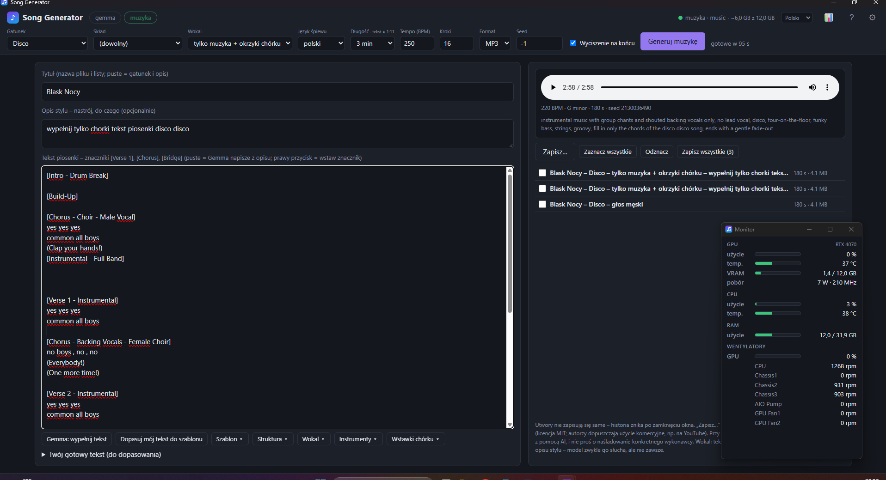
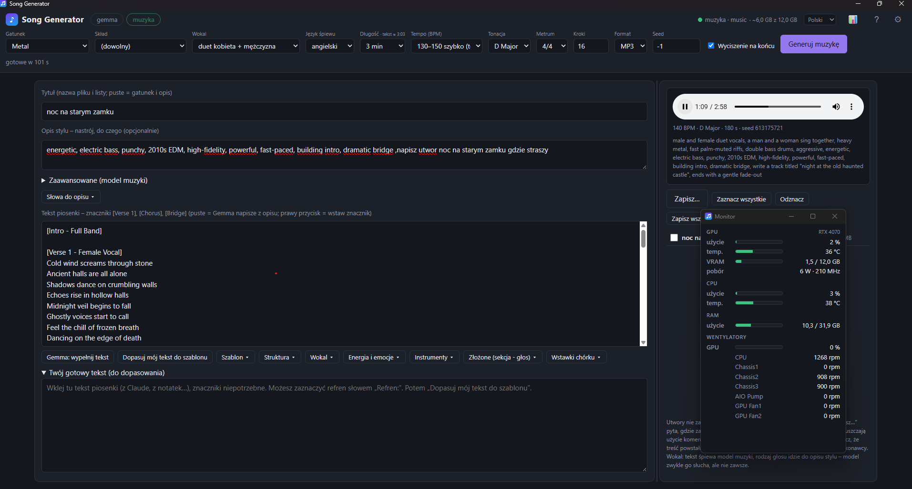

# Examples / Przykłady

## Disco with group chants / Disco z okrzykami chóru

An instrumental disco track whose only "vocals" are chanted shouts and a choir — the lyrics field holds just
the structure tags and the chants. The ready-to-paste text is in [`disco-chants.txt`](disco-chants.txt).
Instrumentalny utwór disco, w którym śpiewają tylko okrzyki i chór — w polu tekstu są same znaczniki struktury
i okrzyki. Gotowy tekst do wklejenia: [`disco-chants.txt`](disco-chants.txt).

| Setting / Ustawienie | Value / Wartość |
|---|---|
| Genre / Gatunek | Disco |
| Vocals / Wokal | **choir** / **chór** (see the note below / patrz uwaga niżej) |
| Singing language / Język śpiewu | Polish / polski |
| Length / Długość | 3 min |
| Tempo (BPM) | 250 |
| Steps / Kroki | 16 |
| Format | MP3 |
| Seed | -1 (random / losowo) |
| Fade out at the end / Wyciszenie na końcu | on / włączone |
| Title / Tytuł | Blask Nocy |
| Style description / Opis stylu | `wypełnij tylko chorki tekst piosenki disco disco` |

Result / Wynik: 2:58, 4.1 MB; the model reported about 220 BPM, G minor / model podał ok. 220 BPM, tonacja g-moll.

**Vocals note / Uwaga o wokalu.** The screenshot was made with *music + choir shouts* (`backing calls`). That mode tells the
model "no lead vocal", so it mostly shouts the bracketed lines `( )` and skips the plain ones. To have the plain lines
sung too, choose **choir** (or a duet) in the Vocals field. Sections tagged `Instrumental` / `Solo` / `Break` should have
no text under them — the app warns about that before generating.
Zrzut powstał w trybie *tylko muzyka + okrzyki*. Ten tryb mówi modelowi „bez głównego wokalu”, więc głównie krzyczy wersy
w nawiasach `( )`, a zwykłe pomija. Żeby śpiewał też zwykłe wersy, wybierz **chór** (albo duet) w polu Wokal. Sekcje
oznaczone `Instrumental` / `Solo` / `Break` nie powinny mieć tekstu pod spodem — aplikacja ostrzega o tym przed generowaniem.

**Listen / Posłuchaj:** [`blask-nocy-5.mp3`](blask-nocy-5.mp3) — take no. 5, made from the lyrics in [`disco-claps.txt`](disco-claps.txt) (3 min, 4.1 MB). The result varies a lot from take to take (seed, steps, how the model reads the tags), so do not expect an identical track; the sample only shows what the model can produce. Generated with the help of AI (ACE-Step 1.5).
**Posłuchaj:** [`blask-nocy-5.mp3`](blask-nocy-5.mp3) — podejście nr 5, z tekstu [`disco-claps.txt`](disco-claps.txt) (3 min, 4,1 MB). Wynik bardzo się różni między podejściami (seed, kroki, sposób odczytania znaczników), więc nie licz na identyczny utwór; próbka pokazuje tylko, co model potrafi. Utwór wygenerowany z pomocą AI (ACE-Step 1.5).

How to use / Jak użyć: pick the settings above (Vocals: choir), paste `disco-chants.txt` into the lyrics field, click
**Generate music** / ustaw powyższe (Wokal: chór), wklej `disco-chants.txt` w pole tekstu, kliknij **Generuj muzykę**.
Note: in the "music + choir shouts" mode Gemma does not write lyrics — you enter them yourself
(see the in-app help) / w trybie „tylko muzyka + okrzyki” Gemma nie pisze tekstu — wpisujesz go sam.

## Disco with claps (experimental) / Disco z klaskaniem (eksperyment)

A longer variant of the same song: [`disco-claps.txt`](disco-claps.txt) (the lyrics of the sample track above) adds a bridge with a solo section and tries
to get real hand claps with the sections `[Instrumental - Hand Claps]` and `[Percussion Break - Claps]`.
Dłuższy wariant tego samego utworu: [`disco-claps.txt`](disco-claps.txt) dodaje bridge z częścią solową i próbuje
uzyskać prawdziwe klaskanie sekcjami `[Instrumental - Hand Claps]` i `[Percussion Break - Claps]`.

**Claps are not guaranteed / Klaskanie nie jest gwarantowane.** ACE-Step has no documented tag for sound effects.
The official songwriting guide ([ACE-Step-1.5, `acestep-songwriting`](https://github.com/ace-step/ACE-Step-1.5/blob/main/.claude/skills/acestep-songwriting/SKILL.md))
lists structure tags (`[Intro]`, `[Verse]`, `[Chorus]`, `[Bridge]`, `[Outro]`, `[Build]`, `[Drop]`, `[Breakdown]`,
`[Instrumental]`, `[Guitar Solo]`, `[Piano Interlude]`, `[Fade Out]`, `[Silence]`) and says to keep the instruments
in the style description consistent with the instrumental sections in the lyrics. It does not mention claps, so the
two clap sections above are an experiment: add `hand claps, rhythmic clapping` to the **style description** and try
a few seeds. A bracketed `(Clap your hands!)` is a choir shout, not clapping.
Oficjalny przewodnik nie wymienia klaskania, więc obie sekcje to eksperyment: dopisz `hand claps, rhythmic clapping`
do **opisu stylu** i wypróbuj kilka seedów. `(Clap your hands!)` w nawiasie to okrzyk chóru, nie klaskanie.

## Same song in three rock genres / Ten sam utwór w trzech gatunkach rocka

The lyrics in [`rock-claps.txt`](rock-claps.txt) (guitar and bass solos, a male-vocal-and-male-choir duet answer after each
chorus, claps in the bridge) rendered in three genres. Only the **Genre** field changed; the text is the same.
Tekst [`rock-claps.txt`](rock-claps.txt) (solówki gitary i basu, „duet” męski głos + męski chór po każdym refrenie,
klaski w bridge'u) wygenerowany w trzech gatunkach. Zmieniało się tylko pole **Gatunek**; tekst jest ten sam.

| Genre / Gatunek | Sample / Próbka | Size / Rozmiar |
|---|---|---|
| Soft rock | [`blask-nocy-soft-rock.mp3`](blask-nocy-soft-rock.mp3) | 4.1 MB |
| Hard rock | [`blask-nocy-hard-rock.mp3`](blask-nocy-hard-rock.mp3) | 4.1 MB |
| Metal (style description: `metal lata 90`) | [`blask-nocy-metal.mp3`](blask-nocy-metal.mp3) | 4.1 MB |

The same caveat applies: every take comes out differently, and the model reads the tags loosely.
Obowiązuje ta sama uwaga: każde podejście wychodzi inaczej, a model czyta znaczniki swobodnie.

**The style description helps / Opis stylu pomaga.** Without a Style description the model tends to make a weaker, more generic
track, and in the first metal take the vocals did not come through. A retest with the field empty (same lyrics and settings)
did sing, only later in the track, so the description is **not** what decides whether vocals appear: the model decides that
loosely, and results vary from take to take. A few words of style are still worth adding because they steer the sound.
Bez opisu stylu model robi zwykle słabszy, bardziej ogólny utwór, a w pierwszym metalu wokal się nie pojawił. Powtórka z pustym
polem (ten sam tekst i ustawienia) jednak zaśpiewała, tylko później w utworze, więc opis **nie** decyduje o tym, czy będzie
wokal: model robi to swobodnie, a wyniki różnią się między podejściami. Kilka słów stylu warto dopisać, bo kierują brzmieniem.

## Disco duet, lyrics written by the app / Disco duet, tekst napisany przez aplikację

The simplest way to use the app: no lyrics of your own, only a genre and a short description. Gemma wrote the lyrics, ACE-Step made the music.
Najprostszy sposób użycia: bez własnego tekstu, tylko gatunek i krótki opis. Tekst napisała Gemma, muzykę ACE-Step.

| Field / Pole | Value / Wartość |
|---|---|
| Genre / Gatunek | Disco |
| Vocals / Wokal | male and female duet / duet kobieta + mężczyzna |
| Style description / Opis stylu | `disco dance track about a summer Saturday night in San Francisco, fast, 80s` |
| Lyrics / Tekst | left empty — Gemma writes them / puste — pisze Gemma |

**Listen / Posłuchaj:** [`disco-san-francisco.mp3`](disco-san-francisco.mp3) and a second run with the same settings, [`disco-san-francisco-2.mp3`](disco-san-francisco-2.mp3) (4.1 MB each).
[`disco-san-francisco.mp3`](disco-san-francisco.mp3) i drugie podejście z tymi samymi ustawieniami, [`disco-san-francisco-2.mp3`](disco-san-francisco-2.mp3) (po 4,1 MB).
The lyrics are different on every run, so there are no text files for these. The two takes show how much the result varies.
Tekst za każdym razem wychodzi inny, więc nie ma dla nich plików z tekstem. Dwa podejścia pokazują, jak bardzo wynik się różni.

## Metal: a night at a haunted castle / Metal: noc na starym zamku

A short style description plus a request for the topic; Gemma wrote the lyrics (the first lines are visible in the screenshot),
ACE-Step made the track. Key and time signature were set in the new **Key** and **Time signature** lists, the tempo from the list of ranges.
Krótki opis stylu i prośba o temat; tekst napisała Gemma (pierwsze wersy widać na zrzucie), muzykę zrobił ACE-Step. Tonację i metrum
ustawiono w nowych listach **Tonacja** i **Metrum**, tempo z listy przedziałów.

| Field / Pole | Value / Wartość |
|---|---|
| Genre / Gatunek | Metal |
| Vocals / Wokal | male and female duet / duet kobieta + mężczyzna |
| Singing language / Język śpiewu | English / angielski |
| Length / Długość | 3 min |
| Tempo (BPM) | 130–150 fast / szybko (140) |
| Key / Tonacja | D Major |
| Time signature / Metrum | 4/4 |
| Steps / Kroki | 16 |
| Format | MP3 |
| Seed | -1 (random / losowo; this take: 613175721) |
| Fade out at the end / Wyciszenie na końcu | on / włączone |
| Title / Tytuł | noc na starym zamku |
| Style description / Opis stylu | `energetic, electric bass, punchy, 2010s EDM, high-fidelity, powerful, fast-paced, building intro, dramatic bridge, napisz utwor noc na starym zamku gdzie straszy` |
| Lyrics / Tekst | left empty — Gemma writes them (structure tags such as `[Intro - Full Band]`, `[Verse 1 - Female Vocal]`) / puste — pisze Gemma |

The style words come from the **Style words** menu (mood, instruments, timbre, era, structure); the last part is a plain request in Polish.
Słowa stylu pochodzą z menu **Słowa do opisu** (nastrój, instrumenty, barwa, epoka, struktura); ostatnia część to zwykła prośba po polsku.

Result / Wynik: 2:58, 4.3 MB, generated in 101 s; the model reported 140 BPM, D Major. The planner turned the description into
`male and female duet vocals… heavy metal, fast palm-muted riffs, double bass drums, aggressive…` and added the fade-out.
Model podał 140 BPM, D-dur; planista rozwinął opis w `male and female duet vocals… heavy metal, fast palm-muted riffs, double bass drums, aggressive…`.

**Listen / Posłuchaj:** [`noc-na-starym-zamku.mp3`](noc-na-starym-zamku.mp3) (4.3 MB).

**About the lyrics / O tekście.** Lyrics written by Gemma are often of poor quality (simple rhymes, repetition). This is why the
app lets you paste your own text (**Your finished lyrics** + **Fit my lyrics to the template**) or generate with no lyrics at all.
Teksty od Gemmy bywają słabej jakości (proste rymy, powtórzenia), dlatego w apce można wkleić własny tekst
(**Twój gotowy tekst** + **Dopasuj mój tekst do szablonu**) albo generować w ogóle bez tekstu.

## Smooth jazz / Smooth jazz

A relaxed smooth-jazz track made in the app (genre **Smooth jazz**).
Spokojny utwór smooth jazz zrobiony w aplikacji (gatunek **Smooth jazz**).

**Listen / Posłuchaj:** [`smooth-jazz.mp3`](smooth-jazz.mp3) (about 4 min, 5.7 MB / ok. 4 min, 5,7 MB).
